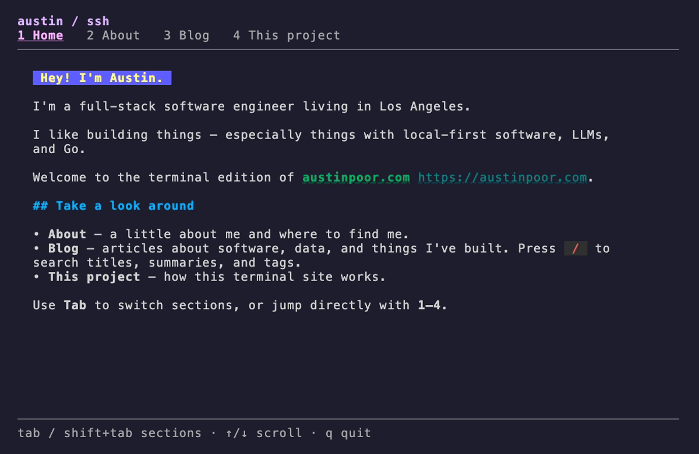

# ssh.austinpoor.com



_created by Austin Poor_

A terminal companion to [austinpoor.com](https://austinpoor.com), built with Go,
Wish, Bubble Tea, Bubbles, Lip Gloss, and Glamour. It has Home, About, Blog, and This
Project sections, with searchable posts and a Markdown reader.

## Run locally

Requires Go 1.27.3 (or automatic toolchain downloads) and a local checkout of the
private website repository:

```sh
make run WEBSITE_DIR=../austinpoor-dot-com
```

`make run` and `make build` refresh the blog snapshot before compiling. `make
build` writes `bin/ssh-austinpoor-com`. To refresh content separately:

```sh
go run ./cmd/sync-content -source /path/to/austinpoor-dot-com
go run .
```

Direct `go run .` / `go build .` use the last imported snapshot. A checkout with
no snapshot still runs, but its blog is empty.

## Serve over SSH

```sh
make serve WEBSITE_DIR=../austinpoor-dot-com
# From another terminal:
ssh -p 2222 localhost
```

`make serve` imports content and starts the server on `127.0.0.1:2222`. Each
connection gets its own viewer and search state. Anyone can browse without an
account; the server provides the terminal site, with no remote command execution,
file transfer, or port forwarding. An active terminal is required (`ssh -t` when
connecting from a script).

The built binary supports both modes:

```sh
bin/ssh-austinpoor-com local
bin/ssh-austinpoor-com serve -addr 127.0.0.1:2222 -host-key .ssh/ssh_host_ed25519_key
bin/ssh-austinpoor-com serve --help
```

The server reads `HOST`, `PORT`, and `HOST_KEY_PATH` as defaults; command-line
flags take precedence. It creates its Ed25519 host key on first use and reuses
it on subsequent starts. The local `.ssh/` directory is excluded from Git and
the Docker build context. Server mode refuses to start without an embedded blog
snapshot, so a fresh checkout must import content before building.

Idle connections expire after 5 minutes, sessions after 1 hour. New sessions
are rate-limited by source IP. On SIGINT/SIGTERM, the server stops accepting
connections and allows 10 seconds for existing connections to close before
closing the remainder.

## Content source

The importer uses the website checkout's `content/seed.json` for titles,
summaries, dates, and tags, and reads the current article bodies from
`content/blog-posts/<slug>.md`. It includes only metadata-listed posts with a
publication date at or before import time, excluding drafts and underscore
files. Posts are sorted newest first. Invalid or missing published content
fails the import without replacing the previous snapshot.

The website currently reads its live blog from a database. This importer uses
the **local content snapshot**; it does not fetch that database. New posts and
metadata edits need to be reflected in `content/seed.json` as well as the
Markdown files. Existing body edits are picked up directly from disk.

The generated `content/posts.json` is Git-ignored and embedded in the Go binary.
The app needs no website checkout, GitHub token, database, or content network
requests at runtime. `make image` imports content before building the container;
the Dockerfile requires the generated bundle to be present in the build context.

Home, About, and This Project are maintained as Markdown in `content/pages/`.
Home/About were adapted from the website's existing copy; they are not parsed
from its Svelte components. Links resolve against the website, and each post
links back to its web version for images and richer content.

If builds move to CI, check out the private website repository during the build
using a repository-scoped read-only credential, then run the same importer.
Keep that credential in CI; the runtime app only receives the published bundle.

## Controls

- `Tab` / `Shift+Tab`, or `1`–`4`: switch sections.
- Arrow keys or `j` / `k`: select posts or scroll.
- `/`: search post titles, summaries, and tags (case-insensitive; all search words must match).
- `Enter`: apply the search, then open the selected post.
- `Esc`: return to the list, cancel search, or clear the filter.
- `q` / `Ctrl+C`: quit (`q` remains usable as text while searching).

## Container and Fly.io

```sh
make image WEBSITE_DIR=../austinpoor-dot-com
docker run --rm -p 127.0.0.1:2222:2222 \
  --mount type=volume,source=ssh-site-keys,target=/shared \
  ssh-austinpoor-com
```

The container runs `serve`, listens on `0.0.0.0:2222`, and stores its host key at
`/shared/ssh_host_ed25519_key`. Reusing the volume preserves its SSH identity.

`fly.toml` maps public TCP port 22 to port 2222, adds a TCP health check, and
mounts the existing `sshshared` volume at `/shared`. The process has a 15-second
shutdown window. Before a Fly deployment, refresh the content locally:

```sh
make content WEBSITE_DIR=../austinpoor-dot-com
flyctl config validate --strict
flyctl deploy --ha=false
```

These commands target the existing `ssh-austinpoor-com` app. Use one serving
machine with its persistent host-key volume; additional machines must share
the same host identity before serving the same hostname. If an existing
deployment uses a different host-key filename, preserve that file and set
`HOST_KEY_PATH` to its path before deploying to avoid changing the public host
identity. Running the local build does not deploy anything.

## Validation

```sh
go test -race ./...
go vet ./...
make build WEBSITE_DIR=../austinpoor-dot-com
```

Tests cover content imports, viewer navigation and search, terminal resizing,
real SSH sessions, session isolation, host-key reuse, and server shutdown. The
demo above still shows the earlier SSH version.
